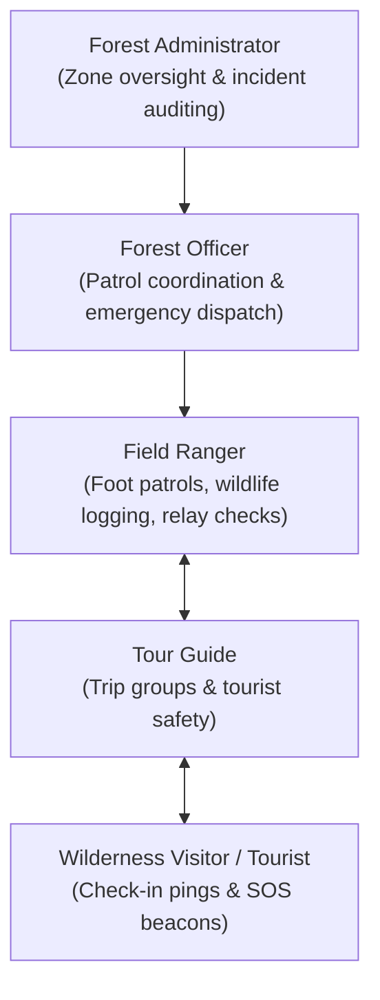

<p align="center">
  
</p>

<h1 align="center">Pulsar Field</h1>

<p align="center">
  <strong>Wilderness Mesh & Remote Operations Platform</strong><br />
  <em>Forest Officers • Field Rangers • Tour Guides • Wilderness Expeditions</em>
</p>

<p align="center">
  <a href="#overview">Overview</a> •
  <a href="#field-roles">Operational Roles</a> •
  <a href="#relay-infrastructure">Relay Infrastructure</a> •
  <a href="#system-architecture">Architecture</a> •
  <a href="#getting-started">Getting Started</a> •
  <a href="#branch-guide">Branch Guide</a>
</p>

---

## Overview

**Pulsar Field** is the dedicated remote operations and wilderness safety edition of the Pulsar decentralized platform.

Designed specifically for rugged, non-urban environments such as national parks, tiger reserves, dense forests, and mountainous terrain where cellular connectivity is nonexistent, Pulsar Field bridges communication across field rangers, officers, guides, and visitors using **Bluetooth Low Energy mesh** and physical **ESP32 solar relay stations**.

---

## Operational Roles



Pulsar Field provides role-based operational interfaces tailored for low-light, high-contrast outdoor visibility:
* **Forest Officer:** Manages patrol routes, monitors active wildlife encounters, reviews team check-ins, and dispatches fire response units.
* **Field Ranger:** Tracks solar relay health, relays field SOS alerts, and receives priority alerts over BLE.
* **Tour Guide:** Generates dynamic, expiring trip groups with QR codes to supervise visitor groups across trails.
* **Visitor / Tourist:** Lightweight emergency beacon that communicates through nearby ranger phones or fixed tree-mounted relay stations without requiring personal SIM cards.

---

## Relay Infrastructure (Physical ESP32 & Simulator)

Wilderness coverage is extended using battery-backed, solar-charged **ESP32 relay stations** deployed at high vantage points or trail intersections:

```text
Visitor Phone ──(BLE)──> Relay Station A ──(BLE/LoRa)──> Relay Station B ──(BLE)──> Ranger Phone
```

### Hardware Specifications & Firmware
* **Microcontroller:** ESP32-WROOM-32 / ESP32-S3
* **Transports:** BLE GATT Server/Client (Service UUID: `0000FE9A-0000-1000-8000-00805F9B34FB`) + optional SX1276 LoRa
* **Power:** 3.7V 18650 Li-ion battery + 5V 2W Solar Panel + TP4056 charging module
* **Firmware:** Located in [`firmware/src/PulsarRelay.ino`](firmware/src/PulsarRelay.ino)
* **Simulator:** Software simulation available in [`firmware/sim/RelaySimulator.ts`](firmware/sim/RelaySimulator.ts) for testing multi-hop routing without physical hardware.

---

## System Architecture

```text
Pulsar/ (Branch: forest-operations)
├── apps/
│   └── mobile/              # React Native Pulsar Field App
│       ├── android/          # Native Kotlin BLE foreground service
│       └── src/
│           ├── features/
│           │   ├── forestmesh/   # Forest Onboarding, Zone Home, Relay Monitor
│           │   ├── disastermesh/ # High-priority Forest SOS
│           │   └── messaging/    # E2E encrypted ranger team chat
│           └── navigation/       # Forest bottom-tab navigator
│
├── packages/
│   ├── mesh-engine/          # Multi-hop packet routing & deduplication
│   ├── shared-types/         # ForestZone, RelayStation, TripGroup data models
│   └── emergency-config/     # Verified helpline numbers (including Forest Helpline 1926)
│
├── backend/                  # Real-time WebSocket + Prisma PostgreSQL server
│   └── prisma/schema.prisma  # Forest zones, patrol teams & relay status entities
│
├── firmware/                 # ESP32 firmware sketch & software simulator
│
└── assets/
    └── branding/             # Pulsar branding assets
```

---

## Getting Started

### Installation & Build

```bash
# Clone and checkout forest-operations branch
git clone https://github.com/swayamprabhu2005/Pulsar.git
cd Pulsar
git checkout forest-operations

# Install dependencies
pnpm install

# Build shared modules & run tests
pnpm --filter @pulsar/shared-types build
pnpm --filter @pulsar/mesh-engine build
pnpm --filter @pulsar/mesh-engine test
```

---

## Branch Guide

| Branch | Purpose |
|---|---|
| `main` | Foundation, core shared packages, Prisma schema, and ESP32 firmware. |
| `community-safety` | **Pulsar Community Safety Edition** (Citizens, SafeWalk, DisasterMesh, CrowdCast). |
| `forest-operations` | **Pulsar Field Edition** (Forest rangers, patrol teams, guides, tourist groups, relay stations). |

---

<p align="center">
  <sub>Pulsar Field • Developed with pride by <a href="https://github.com/swayamprabhu2005">Swayam Kiran Prabhu</a>.</sub>
</p>
